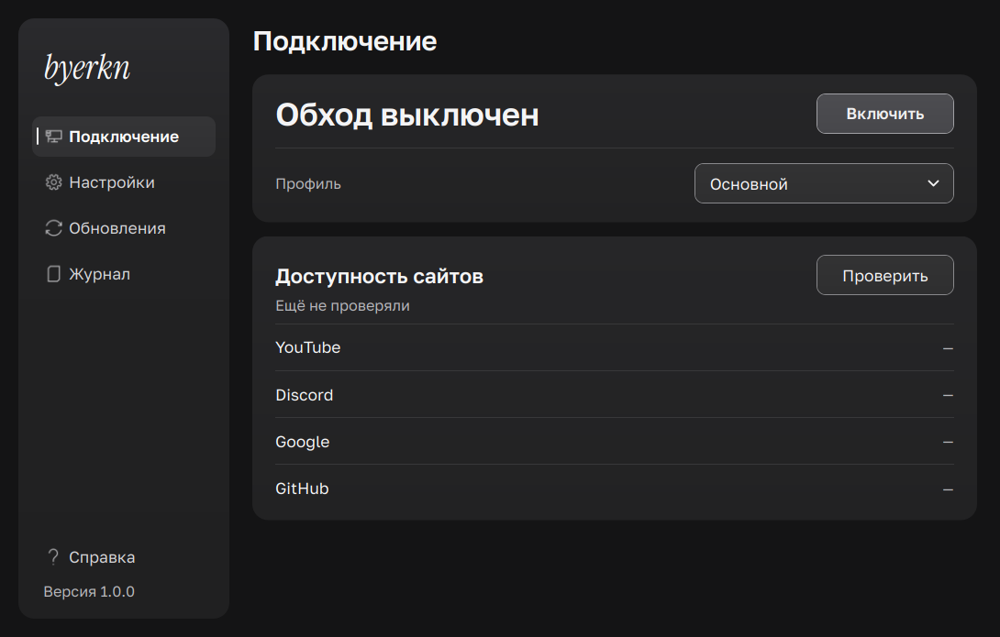

<div align="center">
  
  <h1>byerkn</h1>
  <p>Run zapret, switch profiles, and check site access. A portable app for Windows.</p>
  <p><a href="https://github.com/sstrodee/byerkn/releases/latest"><strong>Download for Windows ↗</strong></a> · <a href="README.ru.md">Русский</a></p>
</div>



## Quick start

1. Download `byerkn-1.0.0-windows-x64.zip` from [Releases](https://github.com/sstrodee/byerkn/releases).
2. Extract the entire archive to a writable folder you control and open `byerkn.exe`. Windows asks for administrator rights to run WinDivert.
3. Select **Основной** and click **Включить**. byerkn starts zapret and checks HTTPS access to YouTube, Discord, Google, and GitHub.
4. To stop zapret and quit, open the tray menu and select **Выключить и выйти**.

**Requirements** · Windows 10 or 11, x64. The archive includes Python, Qt, and zapret. The app interface is in Russian.

## Features

- Switch among Flowseal profiles and run site checks from the same window.
- Keep zapret running in the system tray when the window is closed.
- Add domain lists and exclusions, manage the game filter and IP list, and view logs.
- Update the zapret bundle from GitHub with SHA-256 verification and roll back to the previous version.

## Settings and updates

Settings and logs live in `data` next to `byerkn.exe`. When upgrading byerkn, quit through the tray, extract the new archive to a fresh folder, and copy `data` alongside the new EXE. The **Обновления** page manages the zapret bundle. New versions of byerkn itself are available through GitHub Releases.

The working profile depends on your connection. Site checks report HTTPS access. Test YouTube playback and Discord voice in their respective apps. For profiles, troubleshooting, and data recovery, see the [Windows guide in Russian](docs/windows-guide.md).

## Build from source

```powershell
.\bootstrap.ps1
.\runtime\python.exe -m unittest discover -s tests -p 'test_*.py' -v
.\build_portable.ps1 -Release
```

The release build creates a versioned Windows ZIP and its SHA-256 file under `dist/release-1.0.0`. The [Windows guide](docs/windows-guide.md) includes local build and test details.

byerkn is a companion project to [helloytd](https://github.com/sstrodee/helloytd) and an independent interface for [Flowseal/zapret-discord-youtube](https://github.com/Flowseal/zapret-discord-youtube). The byerkn source uses [MIT](LICENSE). Bundled software has its own [licenses and notices](THIRD_PARTY.md).
