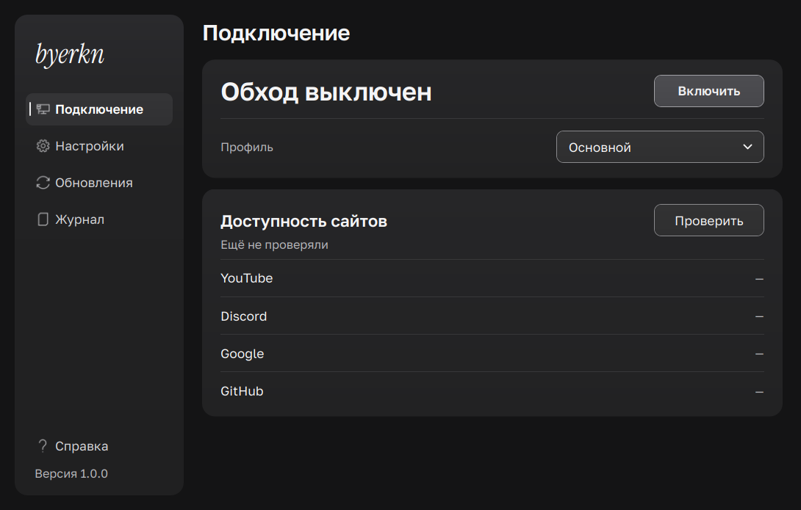

<div align="center">
  
  <h1>byerkn</h1>
  <p>Запуск zapret, выбор профиля и проверка сайтов. Portable-приложение для Windows.</p>
  <p><a href="https://github.com/sstrodee/byerkn/releases/latest"><strong>Скачать для Windows ↗</strong></a> · <a href="README.md">English</a></p>
</div>



## Быстрый старт

1. Скачайте `byerkn-1.0.0-windows-x64.zip` со страницы [Releases](https://github.com/sstrodee/byerkn/releases).
2. Распакуйте весь архив в свою папку с правом записи и откройте `byerkn.exe`. Windows запросит права администратора для WinDivert.
3. Выберите профиль **Основной** и нажмите **Включить**. Программа запустит zapret и проверит HTTPS-доступ к YouTube, Discord, Google и GitHub.
4. Чтобы остановить zapret и закрыть приложение, выберите **Выключить и выйти** в меню значка в трее.

**Требования** · Windows 10 или 11, x64. Python, Qt и zapret входят в архив.

## Возможности

- Профили Flowseal и проверка сайтов в одном окне.
- Работа в трее после закрытия окна.
- Свои списки доменов и исключений, игровой режим, фильтр IP и журнал.
- Обновление файлов zapret с GitHub с проверкой SHA-256 и откатом на предыдущую версию.

## Настройки и обновления

Настройки и журналы лежат в папке `data` рядом с `byerkn.exe`. Чтобы обновить сам byerkn, выйдите из приложения через трей, распакуйте новую версию в отдельную папку и скопируйте туда `data`. Через вкладку **Обновления** обновляются файлы zapret.

Рабочий профиль зависит от подключения. Проверка в byerkn показывает доступность по HTTPS. Воспроизведение видео YouTube и голос Discord проверяйте в самих приложениях. Подробнее о профилях, настройках и восстановлении данных — в [руководстве для Windows](docs/windows-guide.md).

## Сборка из исходников

```powershell
.\bootstrap.ps1
.\runtime\python.exe -m unittest discover -s tests -p 'test_*.py' -v
.\build_portable.ps1 -Release
```

Сборщик создаёт версионный ZIP и файл SHA-256 в `dist/release-1.0.0`.

byerkn — проект из серии [helloytd](https://github.com/sstrodee/helloytd) и независимая оболочка для [Flowseal/zapret-discord-youtube](https://github.com/Flowseal/zapret-discord-youtube). Исходники byerkn распространяются под [MIT](LICENSE). У встроенных компонентов свои [лицензии](THIRD_PARTY.md).
